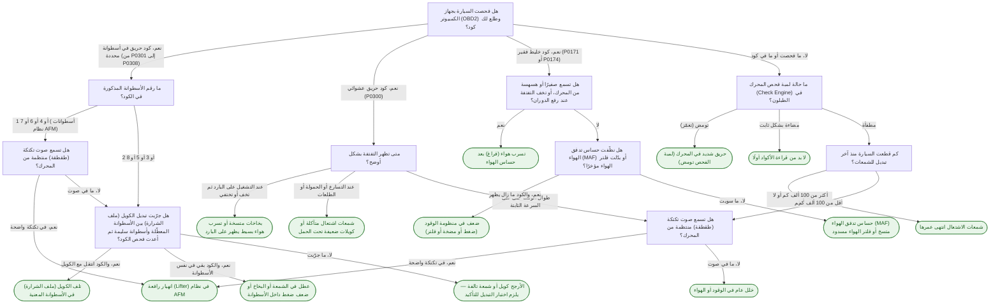
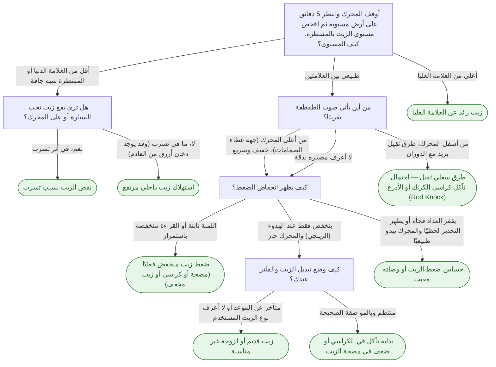
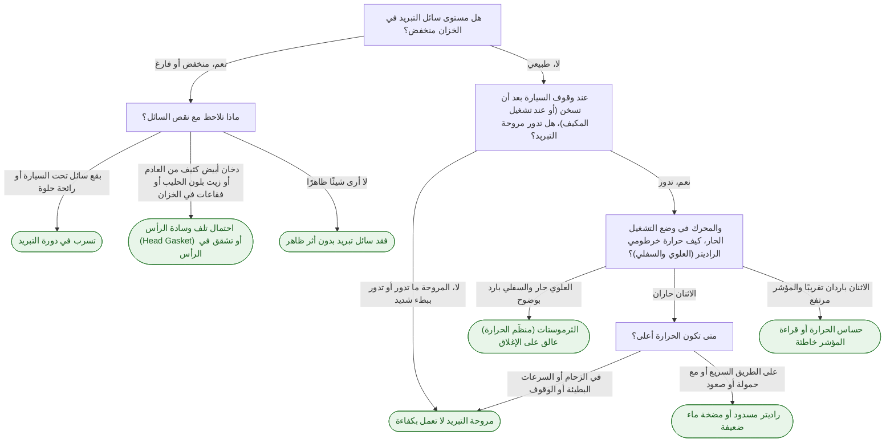

# أشجار القرار

> ملف مُولَّد تلقائيًا من الكود بواسطة `DocsGenerator` — لا تعدّله يدويًا.

## شفروليه تاهو (Chevrolet Tahoe) — محرك V8

### تفتفة في المحرك

- عدد الأسئلة: 10
- عدد الأعطال (النتائج): 13
- أطول مسار: 4 أسئلة

### طقطقة مع انخفاض ضغط الزيت

- عدد الأسئلة: 5
- عدد الأعطال (النتائج): 8
- أطول مسار: 4 أسئلة

### ارتفاع حرارة المحرك

- عدد الأسئلة: 5
- عدد الأعطال (النتائج): 7
- أطول مسار: 4 أسئلة

